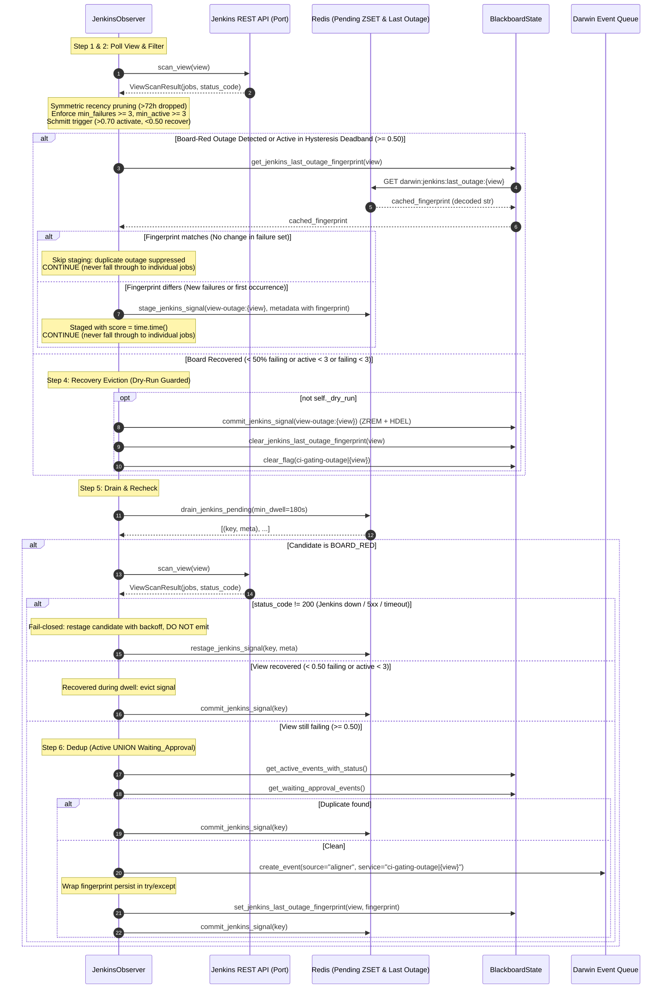

# Technical Implementation Plan: Jenkins Observer False BOARD_RED Sentinel Storms & Close-to-Re-Emit Loops

**Jira Issue:** [VMER-2395](https://redhat.atlassian.net/browse/VMER-2395) | **GitHub Issue:** [#345](https://github.com/The-Darwin-Project/Blackboard/issues/345)  
**Parent Epic:** [VMER-62](https://redhat.atlassian.net/browse/VMER-62) (AI SDLC Darwin)  
**Target Incident:** `evt-d5f7584f` (related: `VMER-2191`, `evt-2aae6f01`)  
**Target Repository:** `BlackBoard` (Service git root: `BlackBoard/`)  

---

## 1. System Architecture & Component Interaction



---

## 2. Merged Evidence Summary

Across all three evidence explorers and Pre-Flight Review (Round 1), the following codebase facts and boundaries were verified against live source files:

1. **`BlackBoard/src/agents/jenkins_observer.py`**:
   - Lines 703–711: Asymmetric pruning currently drops only `job.result == "SUCCESS"`, retaining stale failures indefinitely.
   - Lines 712–732: View ratio evaluation is inlined; lacks separate helper and lacks Schmitt trigger hysteresis state tracking.
   - Lines 734–754: Fallthrough logic stages individual jobs. If `BOARD_RED` is skipped without an unconditional `continue`, or falls through during recovery deadband ($0.50 \le \text{ratio} \le 0.70$), individual failing jobs are staged, creating an alert storm.
   - Lines 756–805: `_clear_recovered_group_flags()` clears escalation flags in Redis upon view recovery, but fails to evict pending `view-outage:{view}` from `JENKINS_PENDING_ZSET` and lacks `if not self._dry_run:` protection.
   - Lines 848–851: `_recheck_and_filter()` contains an unconditional bypass for `BOARD_RED` (`if meta.get("result") == "BOARD_RED": candidates.append((key, meta)); continue`).
   - Lines 853–875: `_recheck_and_filter()` does not inspect `scan.status_code`, failing open when Jenkins returns empty jobs on 5xx or network timeouts. `recheck_cache` maps `str -> list`, discarding `status_code` on cache hits.
   - Lines 909–915: `_is_duplicate_or_escalated()` queries only `get_active_events_with_status()`, missing events parked in `EVENT_WAITING_APPROVAL`.
   - Lines 1028–1039: `_process_candidates()` expects `"fingerprint"` in `meta` when `result == "BOARD_RED"`.

2. **`BlackBoard/src/state/blackboard.py`**:
   - Lines 200–205 & 3168: Lua script `_LUA_SET_MAX` strictly compares numeric values via `tonumber()`. Attempting to store string keys in `last_alerted_build` triggers a Lua comparison error (`attempt to compare number with nil`).
   - Lines 3149–3171: `get_jenkins_last_alerted_build()` and `set_jenkins_last_alerted_build()` enforce integer semantics.
   - Raw Redis `get()` returns `bytes` when `decode_responses=False`. `get_jenkins_last_outage_fingerprint()` must explicitly decode bytes to prevent `b"..." == "..."` equality failures.
   - Lines 2132–2133: `park_for_approval()` migrates event IDs out of `EVENT_ACTIVE` into `EVENT_WAITING_APPROVAL`.
   - Lines 2166–2170: `get_waiting_approval_events()` is already implemented and returns `list[str]`.
   - Lines 3131–3133: `commit_jenkins_signal(key)` atomically executes `zrem` on `darwin:jenkins:pending` and `hdel` on `darwin:jenkins:pending:meta`.

3. **`BlackBoard/src/state/ports.py`**:
   - Contains domain-segregated protocols (`EventRepository`, `ObservationRepository`, etc.). `BlackboardProtocol` does not exist. Existing Jenkins alert methods reside directly in `BlackboardState`. JenkinsObserver types directly against `BlackboardState`.

4. **`BlackBoard/tests/test_jenkins_observer.py`**:
   - Baseline test suite passes 298 tests in ~9.8s.
   - Lines 64–92: `_mock_blackboard()` fixture must mock `get_waiting_approval_events`, `get_jenkins_last_outage_fingerprint`, `set_jenkins_last_outage_fingerprint`, and `clear_jenkins_last_outage_fingerprint`.
   - Lines 1670–1702: `TestTV7dBoardRedActiveFloor` requires `len(active) >= 3` and 3 failures to trigger `BOARD_RED`.

---

## 3. Explorer Agreement Matrix

| Topic / Hypothesis | Explorer A (Deep Trace) | Explorer B (Reasoned Scout) | Explorer C (Probe / Falsification) | Merged Resolution |
| :--- | :--- | :--- | :--- | :--- |
| **`_eval_failure_ratio` existence** | Refuted (inlined at L718 & L790) | Refuted (inlined at L718 & L790) | Refuted (inlined at L718 & L790) | Extract dedicated helper function `_eval_view_health()` returning `(is_outage, failing_jobs, ratio)`. |
| **Outage fingerprint in `last_alerted_build`** | Disagree (violates Lua tonumber) | Disagree (violates Lua tonumber) | Disagree (violates Lua tonumber) | Do NOT modify `last_alerted_build`. Add dedicated methods `get/set/clear_jenkins_last_outage_fingerprint` in `blackboard.py` with byte decoding and 7-day TTL. |
| **Active floor >= 5** | N/A | Contradiction (breaks TestTV7d) | Contradiction (breaks TestTV7d) | Keep floor at `len(active) >= 3` and `len(failing) >= 3` to satisfy `TestTV7d` and prevent false outages. |
| **Pending ZSET eviction on recovery** | Agree (use `commit_jenkins_signal`) | Agree (use `commit_jenkins_signal`) | Agree (use `commit_jenkins_signal`) | In `_clear_recovered_group_flags`, invoke `commit_jenkins_signal(f"view-outage:{view}")` guarded with `if not self._dry_run:`. |
| **Ports Protocol Definition** | Disagree (`BlackboardProtocol` phantom) | Disagree (`BlackboardProtocol` phantom) | Disagree (`BlackboardProtocol` phantom) | Drop `ports.py` modification, keeping parity with lines 3117–3171 in `blackboard.py`. |
| **Waiting approval dedup** | Agree (union with `get_waiting_approval_events`) | Agree (union with `get_waiting_approval_events`) | Agree (union with `get_waiting_approval_events`) | In `_is_duplicate_or_escalated()`, query and union both active and parked events; update test fixture `_mock_blackboard()`. |
| **Fail-closed on 5xx recheck** | Agree | Agree | Agree (restage candidate instead of emitting) | Cache `ViewScanResult` in `recheck_cache`. If status != 200, restage candidate and continue. |

---

## 4. Implementation Strategy

### 4.1 Hexagonal Architecture & Air Gap Compliance
All changes strictly respect existing architectural boundaries:
- **`jenkins_observer.py`**: Contains only observer domain logic (filtering, staging, recheck, hysteresis evaluation). Never calls Redis directly; interacts solely through `BlackboardState` methods.
- **`blackboard.py`**: Encapsulates Redis data structures and atomic operations. Does not import from `src/agents/`. Decodes Redis `bytes` to `str`.
- **`ports.py`**: Left untouched to maintain parity with existing Jenkins alert methods.

### 4.2 Schmitt Trigger Hysteresis & Outage Fingerprint
1. **Activation Threshold**: Failure ratio $> 0.70$ ($70\%$), with `len(failing) >= 3` and `len(active) >= 3`.
2. **Deactivation / Recovery Threshold**: Failure ratio $< 0.50$ ($50\%$), or `len(active) < 3`, or `len(failing) < 3`.
3. **Deadband Handling**: When an outage is already active (`last_fp is not None`) and ratio is between $0.50$ and $0.70$ with $\ge 3$ active and failing jobs, the view remains in outage state. Individual job staging is skipped via `continue`.
4. **Outage Fingerprint Formulation**:
   `fingerprint = f"{len(failing)}:{max(j.build_number or 0 for j in failing)}:{max(j.timestamp or 0 for j in failing)}"`
   Recorded in Redis at `darwin:jenkins:last_outage:{view}` (TTL = 7 days) upon event dispatch. Staging is suppressed if the fingerprint matches the previous alert, preventing re-emission loops when closed. Staged metadata includes `"fingerprint": fingerprint`.

### 4.3 Fail-Closed Recheck & Pending Eviction
1. **Outage Recheck**: Remove the `BOARD_RED` bypass in `_recheck_and_filter()`. Outages are re-evaluated against the view's current health. If recovered ($<0.50$ or active $<3$), the signal is committed (evicted) and suppressed.
2. **Transport Error Shielding**: `recheck_cache` stores `ViewScanResult`. If `scan.status_code != 200` (e.g. 502, 504, None), candidate signals are restaged via `restage_jenkins_signal(key, meta)` rather than emitted.
3. **Recovery Eviction**: `_clear_recovered_group_flags()` explicitly commits `f"view-outage:{view}"` and clears outage fingerprint, guarded by `if not self._dry_run:`.

---

## 5. Atomic Execution Steps

### Step 1: Implement Symmetric Recency Pruning & Outage Health Helper
- **File:** `BlackBoard/src/agents/jenkins_observer.py`
- **Cynefin:** Clear
- **Action:**
  - Add `from typing import TYPE_CHECKING` and `if TYPE_CHECKING: from ..adapters.jenkins import JobResult, ViewScanResult` to ensure type cleanliness.
  - In `_poll_and_stage()`, update the recency filter (lines 703–710) so that **any** job with `job.timestamp is not None and job.timestamp < recency_cutoff_ms` is pruned, regardless of result status (`SUCCESS`, `FAILURE`, `UNSTABLE`). Jobs with `timestamp is None` remain unpruned (preserving `TestTV21FailureNullTimestampStaged`).
  - Extract helper method `_eval_view_health(self, active_jobs: list[JobResult]) -> tuple[bool, list[JobResult], float]`:
    - Filters out in-progress builds (`not (j.result is None and j.build_number is not None)`).
    - Identifies failing jobs via `self._is_triggering_result(j.result)`.
    - Computes `ratio = len(failing) / len(active_jobs) if active_jobs else 0.0`.
    - Returns `(len(active_jobs) >= 3 and len(failing) >= 3 and ratio > 0.70, failing, ratio)`.
- **Verification Command:**
  `cd BlackBoard && uv run --with-requirements requirements.txt --with-requirements requirements-dev.txt pytest tests/test_jenkins_observer.py -k "TestTV7 or TestTV21"`

### Step 2: Implement Schmitt Trigger Hysteresis Deadband, Fingerprint & Fallthrough Suppression
- **File:** `BlackBoard/src/agents/jenkins_observer.py`
- **Cynefin:** Complicated
- **Action:**
  - In `_poll_and_stage()`:
    - Compute `is_outage, failing, ratio = self._eval_view_health(active)`.
    - Fetch `last_fp = await self.blackboard.get_jenkins_last_outage_fingerprint(view)`.
    - Determine active outage state with hysteresis deadband:
      `in_outage = is_outage or (last_fp is not None and ratio >= 0.50 and len(active) >= 3 and len(failing) >= 3)`.
    - If `in_outage`:
      - Construct `fingerprint = f"{len(failing)}:{max(j.build_number or 0 for j in failing)}:{max(j.timestamp or 0 for j in failing)}"`.
      - Stage signal ONLY if entering/renewing outage ($ratio > 0.70$) with a new fingerprint:
        ```python
        if is_outage and last_fp != fingerprint:
            metadata = {
                "job_name": f"view-outage:{view}",
                "version": "multi",
                "view": view,
                "result": "BOARD_RED",
                "build_number": None,
                "url": "",
                "staged_at": time.time(),
                "failing_count": len(failing),
                "active_count": len(active),
                "failure_ratio": ratio,
                "fingerprint": fingerprint,
            }
            await self.blackboard.stage_jenkins_signal(f"view-outage:{view}", metadata)
        ```
      - **CRITICAL**: Execute `continue` unconditionally on the outage branch. Deadband ($0.50 \le ratio \le 0.70$) suppresses staging while continuing to suppress individual job storms (lines 734–754).
  - In `_process_candidates()`:
    - When `meta.get("result") == "BOARD_RED"` and `meta.get("fingerprint")`:
      - Wrap persistence in `try...except Exception as e:` logging warning:
        ```python
        try:
            await self.blackboard.set_jenkins_last_outage_fingerprint(view, meta["fingerprint"])
        except Exception as e:
            logger.warning("Failed to record outage fingerprint for %s: %s", view, e)
        ```
- **Verification Command:**
  `cd BlackBoard && uv run --with-requirements requirements.txt --with-requirements requirements-dev.txt pytest tests/test_jenkins_observer.py -k TestDuplicatePrevention`

### Step 3: Implement Outage Fingerprint Persistence with Byte Decoding in BlackboardState
- **File:** `BlackBoard/src/state/blackboard.py`
- **Cynefin:** Clear
- **Action:**
  - In `BlackboardState`, add:
    - `_JENKINS_LAST_OUTAGE_PREFIX = "darwin:jenkins:last_outage:"`
    - `async def get_jenkins_last_outage_fingerprint(self, view: str) -> str | None:`
      - Reads `val = await self.redis.get(f"{self._JENKINS_LAST_OUTAGE_PREFIX}{view}")`.
      - Decodes if bytes: `return val.decode("utf-8", errors="replace") if isinstance(val, bytes) else (val or None)`.
    - `async def set_jenkins_last_outage_fingerprint(self, view: str, fingerprint: str) -> None:`
      - Executes `await self.redis.set(f"{self._JENKINS_LAST_OUTAGE_PREFIX}{view}", fingerprint, ex=self._JENKINS_LAST_ALERT_TTL)`.
    - `async def clear_jenkins_last_outage_fingerprint(self, view: str) -> None:`
      - Executes `await self.redis.delete(f"{self._JENKINS_LAST_OUTAGE_PREFIX}{view}")`.
  - (No changes to `ports.py`, matching existing Jenkins observer methods).
- **Verification Command:**
  `cd BlackBoard && uv run --with-requirements requirements.txt --with-requirements requirements-dev.txt pytest tests/test_jenkins_observer.py -k TestBlackboardLastAlertedBuild`

### Step 4: Evict Pending Outage Candidates Upon View Recovery with Dry-Run Guard
- **File:** `BlackBoard/src/agents/jenkins_observer.py`
- **Cynefin:** Clear
- **Action:**
  - In `_clear_recovered_group_flags(self, scanned, all_views_ok)` (lines 789–792):
    - When a view recovers (`ratio < 0.50` or `len(active) < 3` or `len(failing) < 3`):
      - Guard all state mutations with `if not self._dry_run:` and wrap in `try...except Exception as e:`:
        ```python
        if not self._dry_run:
            try:
                await self.blackboard.commit_jenkins_signal(f"view-outage:{view}")
                await self.blackboard.clear_jenkins_last_outage_fingerprint(view)
            except Exception as e:
                logger.warning("Failed to clear recovery state for view %s: %s", view, e)
            await self._clear_flag_if_present(_outage_service_key(view), "board recovered")
        ```
- **Verification Command:**
  `cd BlackBoard && uv run --with-requirements requirements.txt --with-requirements requirements-dev.txt pytest tests/test_jenkins_observer.py -k TestGroupFlagRecovery`

### Step 5: Refactor recheck_cache to ViewScanResult and Enforce Fail-Closed Verification
- **File:** `BlackBoard/src/agents/jenkins_observer.py`
- **Cynefin:** Complicated
- **Action:**
  - In `_recheck_and_filter()` (lines 848–875):
    - Type `recheck_cache: dict[str, ViewScanResult] = {}`.
    - If `not self._adapter`: log warning and `return candidates`.
    - When scanning view: `scan = await self._adapter.scan_view(view); recheck_cache[view] = scan`.
    - Check transport status first:
      ```python
      if scan.status_code != 200 or scan.status_code is None:
          logger.warning("Jenkins scan for view %s failed with status %s; restaging candidate", view, scan.status_code)
          await self.blackboard.restage_jenkins_signal(key, meta)
          continue
      ```
    - Update existing per-job loop from `for j in recheck_cache[view]:` to `for j in (scan.jobs or []):`.
    - Remove unconditional `BOARD_RED` bypass (`if meta.get("result") == "BOARD_RED": candidates.append((key, meta)); continue`).
    - For `BOARD_RED` candidate:
      - Filter `scan.jobs` for recency cutoff ($< 72\text{h}$) and exclude in-progress builds (`not (j.result is None and j.build_number is not None)`).
      - Compute `is_outage, failing, ratio = self._eval_view_health(active_jobs)`.
      - If `ratio < 0.50 or len(active_jobs) < 3 or len(failing) < 3` (view recovered during dwell):
        - Evict signal: `await self.blackboard.commit_jenkins_signal(key)`.
        - `continue`
      - Else: view is still failing; append `(key, meta)` to `candidates`.
- **Verification Command:**
  `cd BlackBoard && uv run --with-requirements requirements.txt --with-requirements requirements-dev.txt pytest tests/test_jenkins_observer.py -k TestRecheckAndFilter`

### Step 6: Expand Dedup Check to Union Waiting-Approval Events
- **File:** `BlackBoard/src/agents/jenkins_observer.py`
- **Cynefin:** Clear
- **Action:**
  - In `_is_duplicate_or_escalated(self, service_name)` (lines 909–915):
    - Inspect active events via `status_map = await self.blackboard.get_active_events_with_status()`.
    - Also fetch `waiting_eids = await self.blackboard.get_waiting_approval_events()`.
    - Iterate `waiting_eids`:
      ```python
      for eid in waiting_eids:
          if eid in status_map:
              continue
          evt = await self.blackboard.get_event(eid)
          if evt and evt.service == service_name:
              return True
      ```
    - Preserves existing error handling and restaging logic; keeps `get_active_events_with_status()` signature and WIP semantics completely unchanged.
- **Verification Command:**
  `cd BlackBoard && uv run --with-requirements requirements.txt --with-requirements requirements-dev.txt pytest tests/test_jenkins_observer.py -k TestDedup`

### Step 7: Update Test Harness Fixtures and Add Comprehensive Unit Tests
- **File:** `BlackBoard/tests/test_jenkins_observer.py`
- **Cynefin:** Clear
- **Action:**
  - In `_mock_blackboard()` fixture (line 64):
    - Add `bb.get_waiting_approval_events = AsyncMock(return_value=[])`.
    - Add `bb.get_jenkins_last_outage_fingerprint = AsyncMock(return_value=None)` (guarantees falsiness by default across existing tests).
    - Add `bb.set_jenkins_last_outage_fingerprint = AsyncMock()`.
    - Add `bb.clear_jenkins_last_outage_fingerprint = AsyncMock()`.
  - Add test classes:
    - `TestSymmetricRecencyPruning`: Validates quiet views with stale failures (>72h) are pruned equally and do not trigger `BOARD_RED`.
    - `TestSchmittTriggerOutageHysteresis`: Tests $>0.70$ activation, deadband suppression ($0.50 \le \text{ratio} \le 0.70$), and $<0.50$ deactivation threshold boundaries.
    - `TestOutageFallthroughSuppression`: Verifies that active outage suppresses individual job staging (never falls through to lines 734–754).
    - `TestOutageFingerprintDedup`: Asserts that closing an event does not re-emit `BOARD_RED` if the fingerprint is unchanged.
    - `TestOutageRecoveryPendingEviction`: Verifies that recovering view evicts `view-outage:{view}` from pending queue.
    - `TestGroupRecoveryDryRunNoop`: Verifies `_dry_run=True` does NOT invoke `commit_jenkins_signal` or `clear_jenkins_last_outage_fingerprint`.
    - `TestRecheckFailClosedNetworkError`: Verifies that HTTP 502 or timeout restages candidates without emitting events and preserves `recheck_cache` status.
    - `TestWaitingApprovalDedupUnion`: Asserts candidates matching an event parked in `EVENT_WAITING_APPROVAL` return `is_duplicate = True`.
    - `TestBlackboardLastOutageFingerprint`: Unit test using FakeRedis testing `get`, `set`, `clear`, byte decoding, and TTL.
- **Verification Command:**
  `cd BlackBoard && uv run --with-requirements requirements.txt --with-requirements requirements-dev.txt pytest tests/test_jenkins_observer.py`

---

## 6. Verification & Test Specification (Definition of Done — 4-Layer ATDD Model)

### 6.1 Executable Scenarios & Test Specification Table

| ID | Scenario (Given / When / Then) | DSL Operation / Driver | SUT Target | Expected Output / Assertion | Category |
| :--- | :--- | :--- | :--- | :--- | :--- |
| **T-1** | **Given** a quiet view with 30 successes (>72h) and 6 failures (>72h)<br/>**When** `_poll_and_stage` executes<br/>**Then** all stale jobs are pruned and no `BOARD_RED` candidate is staged | `stage_poll(jobs)` | `jenkins_observer._poll_and_stage` | `assert len(staged_signals) == 0` | Acceptance |
| **T-2** | **Given** a view with 2 active jobs failing (100% failure)<br/>**When** `_poll_and_stage` runs<br/>**Then** `BOARD_RED` is NOT staged because active jobs $< 3$ | `stage_poll(jobs)` | `jenkins_observer._poll_and_stage` | `assert "view-outage" not in staged_signals` | Boundary |
| **T-3** | **Given** a view with 3 active jobs all failing (100% failure)<br/>**When** `_poll_and_stage` runs<br/>**Then** `BOARD_RED` IS staged (satisfies `TestTV7d` floor) | `stage_poll(jobs)` | `jenkins_observer._poll_and_stage` | `assert "view-outage:view" in staged_signals` | Regression |
| **T-4** | **Given** an active outage that previously alerted with fingerprint `F1`<br/>**When** next poll occurs with identical failure jobs<br/>**Then** staging is suppressed as duplicate outage AND individual jobs are NOT staged | `stage_poll(jobs)` | `jenkins_observer._poll_and_stage` | `assert stage_jenkins_signal.call_count == 0` | Unit |
| **T-5** | **Given** an active outage whose failure ratio drops to 60% (deadband)<br/>**When** `_poll_and_stage` and `_clear_recovered_group_flags` run<br/>**Then** outage remains active ($>50\%$ Schmitt trigger) and individual jobs are NOT staged | `stage_poll(ratio=0.60)` | `jenkins_observer._poll_and_stage` | `assert stage_jenkins_signal.call_count == 0`<br/>`assert clear_flag.call_count == 0` | Hysteresis |
| **T-6** | **Given** an active outage whose failure ratio drops to 45% ($<50\%$)<br/>**When** `_clear_recovered_group_flags` runs<br/>**Then** outage flag is cleared, fingerprint cleared, and pending ZSET evicted | `recover_poll(ratio=0.45)` | `jenkins_observer._clear_recovered_group_flags` | `commit_jenkins_signal.assert_called_with("view-outage:view")` | Acceptance |
| **T-7** | **Given** recovery scan running in dry-run mode (`_dry_run=True`)<br/>**When** `_clear_recovered_group_flags` executes on recovered view<br/>**Then** no Redis mutations or flag clears are performed | `dry_run_recover()` | `jenkins_observer._clear_recovered_group_flags` | `commit_jenkins_signal.assert_not_called()`<br/>`clear_outage_fp.assert_not_called()` | Safety |
| **T-8** | **Given** a staged candidate whose recheck returns HTTP 502 / timeout<br/>**When** `_recheck_and_filter` runs<br/>**Then** candidate is restaged with backoff, NOT emitted, and scan status is preserved in cache | `recheck_filter(status=502)` | `jenkins_observer._recheck_and_filter` | `restage_jenkins_signal.assert_called_once()`<br/>`assert candidates == []` | Failure Handling |
| **T-9** | **Given** a candidate matching a service in `EVENT_WAITING_APPROVAL`<br/>**When** `_is_duplicate_or_escalated` evaluates<br/>**Then** candidate is recognized as duplicate | `dedup_check(service)` | `jenkins_observer._is_duplicate_or_escalated` | `assert is_duplicate is True` | Integration |
| **T-10** | **Given** real FakeRedis instance with raw byte values stored<br/>**When** `get_jenkins_last_outage_fingerprint` runs<br/>**Then** string decoded properly and expires after TTL without comparison failure | `state_driver(redis)` | `blackboard.BlackboardState` | `assert await bb.get_jenkins_last_outage_fingerprint(view) == "fp"` | Unit (FakeRedis) |

### 6.2 Test Infrastructure & Driver Notes
- **Harness**: `pytest-asyncio` with `asyncio: mode=Mode.AUTO` in `BlackBoard/pytest.ini`.
- **Mocks**: `_mock_blackboard()`, `_make_adapter()`, `_make_observer()` in `tests/test_jenkins_observer.py`.
- **Verification Execution**: Scoped verification:
  `cd BlackBoard && uv run --with-requirements requirements.txt --with-requirements requirements-dev.txt pytest tests/test_jenkins_observer.py -k "TestSymmetric or TestSchmitt or TestOutage or TestRecheck or TestWaiting or TestGroupRecoveryDryRun"`
  Full regression verification:
  `cd BlackBoard && uv run --with-requirements requirements.txt --with-requirements requirements-dev.txt pytest tests/test_jenkins_observer.py` (Must pass $\ge 306$ tests with 0 failures).

---

## 7. Definition of Done Checklist

- [ ] SUT: `BlackBoard/src/agents/jenkins_observer.py` prunes stale builds symmetrically across all statuses.
- [ ] SUT: Minimum active floor ($\ge 3$), Schmitt trigger hysteresis ($>70\%$ activate, $<50\%$ recover), and deadband suppression implemented and verified against `TestTV7d`.
- [ ] SUT: `_poll_and_stage` executes unconditional `continue` on outage branch, preventing individual job storm fallthrough.
- [ ] SUT: `BlackBoard/src/state/blackboard.py` implements `get/set/clear_jenkins_last_outage_fingerprint` with byte decoding and Redis `SETEX` (7-day TTL).
- [ ] SUT: `_clear_recovered_group_flags` evicts pending `view-outage:{view}` via `commit_jenkins_signal` and clears fingerprint, protected by `if not self._dry_run:`.
- [ ] SUT: `_recheck_and_filter` refactors `recheck_cache` to `ViewScanResult`, removes `BOARD_RED` bypass, and fails closed on non-200 / transport errors.
- [ ] SUT: `_is_duplicate_or_escalated` unions `get_waiting_approval_events()` with active events without modifying `get_active_events_with_status()` signature.
- [ ] Tests: Scoped unit tests run cleanly in $<2\text{s}$; full `test_jenkins_observer.py` suite passes 100% in $<10\text{s}$.
- [ ] Git: Codebase adheres to `@ai-shebang` directives, ESM/Python guidelines, and zero leaked absolute workstation paths.

---

## 8. Revision History

| Update | Source pre-flight | Confidence then | Summary |
| :--- | :--- | :--- | :--- |
| 2026-11-18 11:12 | `jenkins-observer-board-red-storm-Pre-Flight-Review_2026-11-18_1109.md` | 78% Caution | Applied A-1 (helper signature & type import), A-2 (deadband suppression, metadata fingerprint, fallthrough continue, Redis write try/except), A-3 (drop `ports.py`, decode Redis bytes), A-4 (`_dry_run` guard on recovery cleanup), A-5 (`recheck_cache` to `ViewScanResult`, prune before recheck health eval, align $<0.50$ threshold), A-6 (add dry-run and FakeRedis test scenarios T-5, T-7, T-10), A-7 (align sequence diagram). |
| 2026-11-18 11:20 | `jenkins-observer-board-red-storm-Pre-Flight-Review_2026-11-18_1120.md` | 88% Caution | Applied A-8 (`ViewScanResult` import, `_is_triggering_result`, in-progress filter), A-9 (deadband `is_outage and last_fp != fingerprint` condition, full baseline metadata envelope), A-10 (`try...except` around recovery eviction), A-11 (`self._adapter`, `(scan.jobs or [])` iteration, in-progress filter in recheck), A-12 (skip existing status_map IDs in waiting-approval loop), A-13 (`AsyncMock(return_value=None)` for outage fingerprint). |
