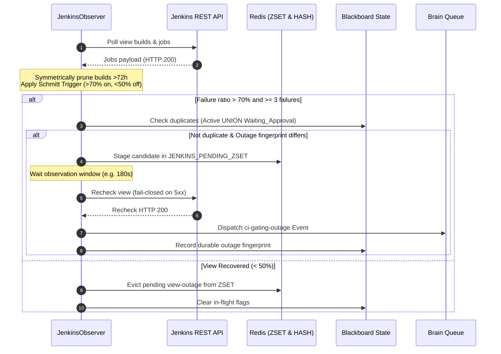

# Exploration Design Brief: jenkins-observer-board-red-storm (VMER-2395)

### 1. Problem & Goals
- **Problem:** Production incident `evt-d5f7584f` triggered ~60 duplicate `ci-gating-outage|Gating Wrappers` events every 5–10 minutes. Quiet views with historical failures but no new activity falsely exceeded the 70% threshold due to asymmetric recency pruning. When closed, events immediately re-emitted because outage events (`build_number: None`) lacked a durable Redis fingerprint. Furthermore, recovery failed to evict pending candidates, rechecks bypassed outages and failed open on network 5xx errors, and dedup checks ignored events parked in `EVENT_WAITING_APPROVAL`.
- **Goals:**
  1. Make recency pruning strictly symmetric across all build results (prune `SUCCESS`, `FAILURE`, `UNSTABLE` >72h equally).
  2. Require a minimum failure count floor ($min\_failures \ge 3$, $min\_builds \ge 5$) and Schmitt trigger hysteresis ($>70\%$ activate, $<50\%$ recover) before signaling `BOARD_RED`.
  3. Store a durable view outage fingerprint in Redis (`last_alerted_build` or synthetic hash) so closing an event does not cause an immediate re-emission loop while the condition is unchanged.
  4. Explicitly evict pending `view-outage:<view>` candidates from `JENKINS_PENDING_ZSET` when the view recovers, and subject outages to recheck without bypass.
  5. Fail-closed on network errors / HTTP 5xx during candidate rechecks.
  6. Expand dedup checking in `jenkins_observer.py` to union `get_active_events_with_status()` with `get_waiting_approval_events()`.
- **Non-Goals:**
  - Do NOT modify `get_active_events_with_status()` signature or behavior in `blackboard.py` (critical WIP limit invariant).
  - Do NOT alter other observer types or unrelated event sources.

### 2. Constraints & Prior Art
- **Architectural Invariant:** Service Git root is `BlackBoard/`.
- **Control Theory:** Simple controller, closed-loop hysteresis, fail-closed boundaries.
- **Prior Art / Incidents:**
  - PR #215 (asymmetric filter & `BOARD_RED`)
  - PR #219 (`last_alerted_build` integer restriction)
  - PR #242 (`triggerStates` Helm externalization)
  - PR #306 (CAS lazy escalation flag prune)
  - `evt-d5f7584f`, `VMER-2191`, `evt-2aae6f01`
- **Docs-Hub scan:** No existing plans for `jenkins_observer` in `docs-hub/Plans/`.

### 3. Proposed Approach (Pre-Evidence)
- **jenkins_observer.py:**
  - Update `_eval_failure_ratio` to prune all statuses older than `RECENCY_WINDOW_HOURS`.
  - Add minimum failure count floor ($N \ge 3$) and hysteresis logic.
  - In `_clear_recovered_group_flags`, issue `ZREM` against `JENKINS_PENDING_ZSET` for `view-outage:{view_name}`.
  - In `_recheck_and_filter`, remove `BOARD_RED` bypass; check `scan.status_code == 200` and fail-closed on 5xx/timeouts.
  - In `_is_duplicate_or_escalated`, query both active events and waiting approval events.
- **blackboard.py:**
  - Enable durable storage of outage fingerprint in Redis `darwin:jenkins:last_alerted` or view outage metadata when `build_number` is None or synthetic string.

### 4. Suspected Impact
- **Components:** `src/agents/jenkins_observer.py`, `src/state/blackboard.py`.
- **Downstream Consumers:** Darwin event queue (`darwin:event:queue`), Brain ReconcileScheduler, Slack notification channels, FlowCollector.
- **Tests:** `tests/test_jenkins_observer.py`, `tests/test_blackboard.py`.

### 5. Open Questions for Explorers
1. **Q1 (Recency & Hysteresis):** How is `_eval_failure_ratio` currently invoked across polling loops, and what data structure stores `active_builds`? Is the hysteresis state tracked per-view in Redis or in-memory?
2. **Q2 (Outage Fingerprint):** Exactly how does `last_alerted_build` in `blackboard.py` parse and store build numbers? Can it accept string keys (e.g. `f"outage:{ts}"`) or does it enforce `int(build_number)`?
3. **Q3 (Pending ZSET Keys):** What exact key format does `JENKINS_PENDING_ZSET` use for staged outage candidates? Does `_clear_recovered_group_flags` have access to the Redis client to perform `ZREM`?
4. **Q4 (Recheck Flow):** What does `_recheck_and_filter` return when `scan.status_code != 200`, and how does the drain loop handle a `False` vs error return?
5. **Q5 (Waiting Approval API):** Does `blackboard.py` already expose `get_waiting_approval_events()`? What is its return signature and data type?

### 6. Architecture Map (Mermaid)

### 7. Exploration Success Criteria
- Exact line numbers and functions verified in `src/agents/jenkins_observer.py` and `src/state/blackboard.py`.
- Redis schema and type constraints confirmed for `last_alerted_build` and pending ZSET.
- `@ai-shebang` directives documented for all touched files.
- Test suite verification commands and baseline test patterns identified.
