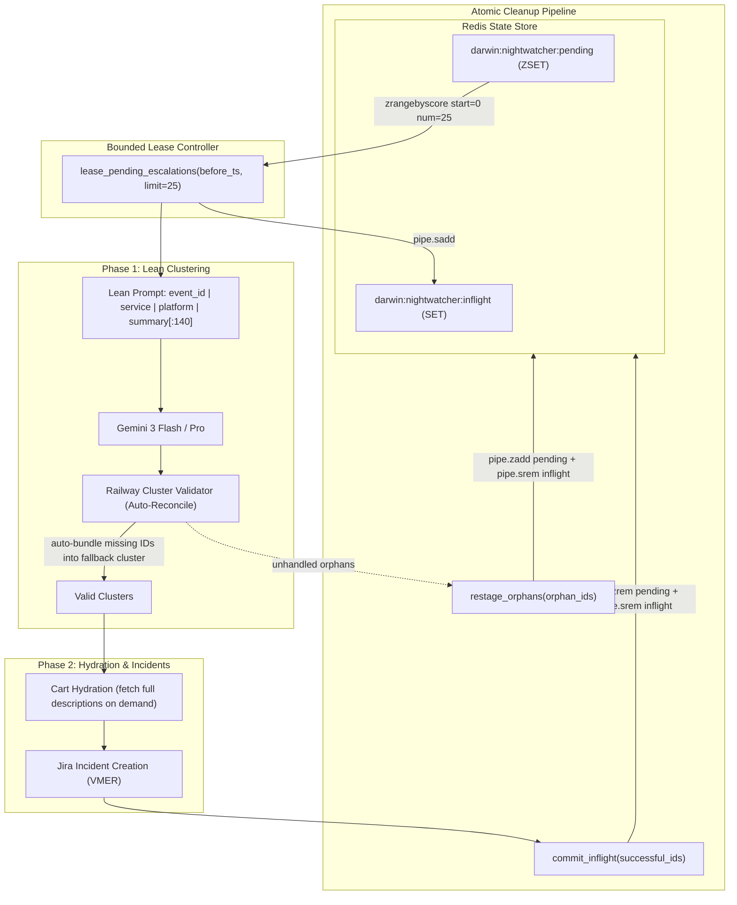

# Technical Implementation Plan: Nightwatcher Backlog & Quota Deadlock Remediation

**Jira Tracking:** [VMER-2236](https://redhat.atlassian.net/browse/VMER-2236) (Parent Epic: [VMER-62](https://redhat.atlassian.net/browse/VMER-62)) | **Attachment Status:** [Plan File Attached (ID: 1291380)](https://redhat.atlassian.net/rest/api/3/attachment/1291380)

---

## Amendment Ledger (Pre-Flight Convergence Rev 1.1)

| ID | Auditor | Finding / Gap | Concrete Resolution |
| :--- | :--- | :--- | :--- |
| **AL-1** | Auditor C | `restage_orphans` contract & FIFO break: overwriting `staged_at` with `now` destroys queue order; dropping `-> int` breaks callers; dropping `json.loads` try/catch risks corrupt batch abort. | Retain `restage_orphans(...) -> int` signature. Parse `data.get("staged_at", 0.0)` in a pre-scan with corrupt JSON isolation. Batch `pipe.zadd` (with parsed `staged_at` score) and `pipe.srem(NIGHTWATCHER_INFLIGHT)` in an atomic pipeline. Return count. |
| **AL-2** | Auditor B | `QuotaExhaustedError` propagation: abruptly raising error breaks deadlock but risks pod crash loops if unhandled by observer loop. | In `_sweep` (`src/observers/nightwatcher.py`), add dedicated `except QuotaExhaustedError as qe:` handler. Log warning, call `await self.blackboard.restage_orphans(json_members)`, and record `ShiftReport(status="quota_exhausted")`. |
| **AL-3** | Auditor C | Null-safety: `e.summary[:140]` throws `TypeError` if `e.summary` is None. | Update format string to null-safe expression: `(e.summary or "")[:140]`. |
| **AL-4** | Auditors A, B | Downstream Phase 2 compatibility: synthetic fallback cluster missing required fields (`title`, `platform`, `events`, `reasoning`) causes Phase 2 cart hydration / Jira generation failure. | Structure fallback cluster with valid taxonomy: inherit `platform` from existing cluster or `VALID_PLATFORMS`, assign `title="Unassigned Staged Escalations (Auto-Reconciled)"`, `events=sorted(list(missing))`, `reasoning="..."`. |
| **AL-5** | Auditors A, B | Drain script connection isolation: ad-hoc connection code risks auth/timeout mismatches. | In `scripts/drain_nightwatcher_backlog.py`, bootstrap Redis client using standard environment variables (`REDIS_URL`, `REDIS_PASSWORD`) with explicit `socket_timeout=30`. |

---

## 1. Problem Statement & Root Cause Synthesis

Since 2026-10-23, Nightwatcher has failed 24 consecutive shift sweeps (`/shifts/list?days=14`), leaving 724 pending escalations (~8.56 MB) trapped in Redis (`darwin:nightwatcher:pending`).

Codebase and log exploration confirmed 5 compounding latent defects:
1. **Mathematical Quota Deadlock (`src/agents/llm/quota_tracker.py`)**: `acquire(estimate)` checks `current + estimate <= self._burst_limit` (500k tokens). An unbounded lease loads all 724 escalations into Phase 1, yielding an estimate of ~1,000,000 tokens. Because `estimate > burst_limit`, this condition can never evaluate to True. The loop sleeps until its 120s deadline, raising `QuotaExhaustedError`.
2. **Unbounded Lease Query (`src/state/blackboard.py`)**: `lease_pending_escalations(before_ts)` queries `zrangebyscore("-inf", before_ts)` without a `LIMIT`. It leases all pending items into the inflight set in one batch. On sweep failure, `requeue_inflight()` returns all items to pending, creating an accumulating death spiral.
3. **Phase 1 Prompt Bloat (`src/observers/nightwatcher.py`)**: `_run_analysis_loop` concatenates full `e.description` text (including full stack traces and Bazel build logs) for every leased item into the initial user turn. For clustering, the LLM only needs high-level metadata; full reports are hydrated on demand during Phase 2 cart generation.
4. **All-or-Nothing Cluster Validation Abort (`src/observers/nightwatcher_tools.py`)**: `validate_cluster_plan` strictly enforces that all manifest IDs must be present in declared clusters (`missing == set()`). If the LLM omits a single ID, it retries twice and then throws `RuntimeError`, aborting the shift and requeueing 100% of escalations.
5. **Inflight Set Leak (`src/state/blackboard.py`)**: `restage_orphans()` calls `zadd(NIGHTWATCHER_PENDING)` but omits `srem(NIGHTWATCHER_INFLIGHT)`. On pod restart, `requeue_inflight()` duplicates them back into pending until the 1-hour TTL expires.

---

## 2. Architecture Control Loop



---

## 3. Merged Evidence Summary & Agreement Matrix

All three parallel explorers investigated the codebase and independently corroborated the findings:

| Topic | Explorer A (Deep Trace) | Explorer B (Reasoned Scout) | Explorer C (Probe & Correctness) | Merged Resolution |
| :--- | :--- | :--- | :--- | :--- |
| **Quota Tracker Deadlock** | Verified (`current + est <= burst`) | Verified line 52 (`acquire`) | Verified mathematical deadlock | Fast-fail: raise `QuotaExhaustedError` immediately if `estimate > burst_limit` |
| **Unbounded Lease** | Verified line 2833 (`zrangebyscore`) | Verified lack of `start`/`num` | Verified line 2847 (`zrangebyscore`) | Add `limit: int = 25` using Redis `start=0, num=limit` |
| **Inflight Leak in `restage_orphans`** | Verified missing `srem` | Verified line 2903 missing `srem` | Verified missing `srem` (leak to TTL) | Pipeline `zadd(PENDING)` and `srem(INFLIGHT)` while preserving `staged_at` |
| **Phase 1 Prompt Bloat** | Verified line 196 (`e.description`) | Verified line 191 (`_run_analysis_loop`) | Verified line 197 (`\n{e.description}`) | Strip `e.description`; emit lean single-line null-safe summaries |
| **Cluster Validator Abort** | Verified line 87 strict error | Verified line 87 `manifest_ids` check | Verified pure function constraint | Auto-reconcile missing IDs into taxonomy-valid fallback cluster |
| **Naming Mismatch in Brief** | Noted: `commit_inflight` (not `ack`) | Noted: `commit_inflight` (not `ack`) | Noted: `commit_inflight` (not `ack`) | Use `commit_inflight(json_members)` consistently |
| **Unit Test Suite** | Located test modules in `tests/` | Mocked Redis/LLM pattern | Identified isolated tool test patterns | Verified 6 test files in `tests/test_nightwatcher_*.py` |

---

## 4. Implementation Strategy

1. **Hexagonal Boundary & Pipelined Redis**:
   - In `src/state/blackboard.py`, preserve strict Redis transaction hygiene (`WATCH/MULTI/EXEC` or atomic pipelines).
   - In `lease_pending_escalations`, add `limit: int = 25` using Redis `zrangebyscore(..., start=0, num=limit)`.
   - In `restage_orphans`, batch operations inside an atomic pipeline: preserve `staged_at` FIFO ordering from JSON payloads, add to pending, and remove from inflight via `pipe.srem`.
2. **Deterministic Rate Limiter Guard & Safe Observer Catch**:
   - In `src/agents/llm/quota_tracker.py`, evaluate payload size against `_burst_limit` before entering the sleep-retry loop. Reject oversize payloads immediately.
   - In `src/observers/nightwatcher.py`, catch `QuotaExhaustedError` explicitly, restage inflight items via `restage_orphans`, and write `ShiftReport(status="quota_exhausted")`.
3. **Lean Payload & Bounded Sweep Control**:
   - In `src/observers/nightwatcher.py`, introduce `NIGHTWATCHER_BATCH_SIZE = int(os.environ.get("NIGHTWATCHER_BATCH_SIZE", "25"))`.
   - In `_run_analysis_loop`, construct the Phase 1 prompt with single-line null-safe summaries: `f"- {e.event_id}: [{e.service}] ({e.platform}) {(e.summary or '')[:140]}"`.
4. **Railway Cluster Validator (Self-Healing & Taxonomy-Safe)**:
   - In `src/observers/nightwatcher_tools.py`, make `validate_cluster_plan` self-healing: if `missing = manifest_ids - all_assigned` is non-empty, auto-bundle missing IDs into an `"Unassigned Staged Escalations (Auto-Reconciled)"` cluster with valid `platform` from `VALID_PLATFORMS`, log a warning, and succeed.
5. **Two-Tier Backlog Drain Script**:
   - Create `scripts/drain_nightwatcher_backlog.py` using standard Redis connection parameters (`REDIS_URL`, `REDIS_PASSWORD`, `socket_timeout=30`) to age off stale CI build duplicates (>7d) and drain the remaining queue in bounded batches.

---

## 5. Atomic Execution Steps

### Step 1: Quota Tracker Fail-Fast Guardrail & Observer Error Handler
- **Target Files:** `src/agents/llm/quota_tracker.py`, `src/observers/nightwatcher.py`
- **Cynefin:** Clear (Good Practices)
- **Change 1 (`quota_tracker.py`):** In `QuotaTracker.acquire(estimated_tokens: int, timeout: float = 120.0)`:
  ```python
  if estimated_tokens > self._burst_limit:
      raise QuotaExhaustedError(
          f"Estimated tokens ({estimated_tokens}) exceed burst limit ({self._burst_limit}). "
          "Reduce batch size before retrying."
      )
  ```
- **Change 2 (`nightwatcher.py`):** In `_sweep`, add explicit handler before `except Exception:`:
  ```python
  except QuotaExhaustedError as qe:
      logger.warning("Nightwatcher sweep paused due to quota exhaustion: %s", qe)
      await self.blackboard.restage_orphans(json_members)
      quota_report = ShiftReport(
          shift_date=shift_date, window=window,
          window_start=window_start, window_end=window_end,
          status="quota_exhausted", started_at=sweep_start, completed_at=time.time(),
      )
      await self.blackboard.persist_shift_report(quota_report)
  ```
- **Verification:** Unit test asserting `acquire` raises immediately and `_sweep` persists `"quota_exhausted"` report without crashing.

### Step 2: Bounded Lease Query in Blackboard State
- **Target File:** `src/state/blackboard.py`
- **Cynefin:** Clear (Good Practices)
- **Change:** Update `lease_pending_escalations`:
  ```python
  async def lease_pending_escalations(
      self, before_ts: float, limit: int = 25
  ) -> list[StagedEscalation]:
      # ...
      members = await pipe.zrangebyscore(
          self.NIGHTWATCHER_PENDING, "-inf", before_ts, start=0, num=limit
      )
  ```
- **Verification:** Unit test asserting `lease_pending_escalations` returns at most `limit` items when ZSET size > limit.

### Step 3: Atomic Inflight Cleanup & FIFO Preservation in `restage_orphans`
- **Target File:** `src/state/blackboard.py`
- **Cynefin:** Clear (Good Practices)
- **Change:** Replace unpipelined implementation with atomic pipeline, preserving `staged_at` scores and clearing inflight:
  ```python
  async def restage_orphans(self, json_members: list[str]) -> int:
      """Re-stage orphan escalations back to pending ZSET for next sweep and clear inflight."""
      import json as _json
      valid_items: list[tuple[str, float]] = []
      for jm in json_members:
          try:
              data = _json.loads(jm)
              valid_items.append((jm, float(data.get("staged_at", 0.0))))
          except Exception:
              logger.warning("Nightwatcher: corrupt orphan skipped: %s", jm[:100])
      if not valid_items:
          return 0

      async with self.redis.pipeline(transaction=True) as pipe:
          for jm, staged_at in valid_items:
              pipe.zadd(self.NIGHTWATCHER_PENDING, {jm: staged_at})
              pipe.srem(self.NIGHTWATCHER_INFLIGHT, jm)
          await pipe.execute()

      logger.warning("Nightwatcher: restaged %d orphan escalations and cleared inflight", len(valid_items))
      return len(valid_items)
  ```
- **Verification:** Unit test asserting items return to pending with original `staged_at` scores, are removed from inflight, and function returns integer count.

### Step 4: Bounded Batch Ingestion & Null-Safe Lean Phase 1 Prompt
- **Target File:** `src/observers/nightwatcher.py`
- **Cynefin:** Complicated (Good Practices)
- **Change:**
  1. Define `NIGHTWATCHER_BATCH_SIZE = int(os.environ.get("NIGHTWATCHER_BATCH_SIZE", "25"))`.
  2. Pass `limit=NIGHTWATCHER_BATCH_SIZE` into `lease_pending_escalations`.
  3. In `_run_analysis_loop`, format items with null-safe summary truncation:
     ```python
     escalation_text = "\n".join(
         f"- **{e.event_id}** | {e.service} | {e.platform} | {(e.summary or '')[:140]}"
         for e in escalations
     )
     ```
- **Verification:** Unit test asserting prompt character length is bounded and handles `summary=None` without `TypeError`.

### Step 5: Railway Auto-Reconciliation with Platform Taxonomy
- **Target File:** `src/observers/nightwatcher_tools.py`
- **Cynefin:** Complicated (Good Practices)
- **Change:** In `validate_cluster_plan`, when `missing = manifest_ids - all_assigned` is not empty:
  ```python
  missing = manifest_ids - all_assigned
  if missing:
      default_platform = clusters[0].get("platform", "general") if clusters else "general"
      if VALID_PLATFORMS and default_platform not in VALID_PLATFORMS:
          default_platform = next(iter(VALID_PLATFORMS)) if VALID_PLATFORMS else "general"
      fallback_cluster = {
          "title": "Unassigned Staged Escalations (Auto-Reconciled)",
          "platform": default_platform,
          "events": sorted(list(missing)),
          "reasoning": "Automatically grouped by Railway Validator: unassigned during model clustering pass.",
      }
      clusters.append(fallback_cluster)
      logger.warning("Railway Validator: auto-reconciled %d unassigned events into fallback cluster", len(missing))
  return True, ""
  ```
- **Verification:** Unit test passing partial clusters asserts `validate_cluster_plan` returns `(True, "")` and appends fallback cluster with valid platform.

### Step 6: Standalone Backlog Drain Utility with Standard Config Bootstrap
- **Target File:** `scripts/drain_nightwatcher_backlog.py`
- **Cynefin:** Complicated (Good Practices)
- **Change:** Create standalone utility bootstrapping Redis via standard env:
  ```python
  redis_url = os.getenv("REDIS_URL", "redis://localhost:6379/0")
  redis_password = os.getenv("REDIS_PASSWORD", None)
  client = Redis.from_url(redis_url, password=redis_password, socket_timeout=30)
  ```
  CLI Flags:
  - `--dry-run`: Inspect backlog composition and age breakdown without mutations.
  - `--age-off-days <int>`: Prune stale CI build duplicates older than N days (default 7).
  - `--batch-size <int>`: Drain active items in bounded batches (default 25).
  - `--delay-seconds <int>`: Cooldown between drain batches (default 45).
- **Verification:** Execute `python scripts/drain_nightwatcher_backlog.py --dry-run` against staging/mock Redis.

### Step 7: ATDD Test Suite
- **Target File:** `tests/test_nightwatcher_deadlock_remediation.py`
- **Cynefin:** Complicated (Good Practices)
- **Change:** Implement scenarios T-1 through T-6 in dedicated test module.
- **Verification:** Run `pytest tests/test_nightwatcher_deadlock_remediation.py` with 100% pass rate.

---

## 6. Verification & Test Specification (Dave Farley 4-Layer ATDD Model)

### 6a. Executable Scenarios Table

| ID | Scenario (Given / When / Then) | DSL Operation / Driver | SUT Target | Expected Output / Assertion | Category |
| :--- | :--- | :--- | :--- | :--- | :--- |
| **T-1** | Given 724 items in `darwin:nightwatcher:pending`, When `lease_pending_escalations(ts, limit=25)` is invoked, Then exactly 25 items are leased and added to inflight. | `driver.seed_pending(724).lease(limit=25)` | `src/state/blackboard.py` | `len(leased) == 25` and `len(inflight) == 25` and `len(pending) == 699` | Acceptance |
| **T-2** | Given an estimated token payload of 1,000,000 and burst limit of 500,000, When `quota_tracker.acquire(1_000_000)` is called, Then it raises `QuotaExhaustedError` immediately. | `driver.call_acquire(1_000_000)` | `src/agents/llm/quota_tracker.py` | Elapsed time < 0.1s and raises `QuotaExhaustedError` | Unit / Performance |
| **T-3** | Given orphaned escalations in inflight set with varied `staged_at`, When `restage_orphans(orphans)` is called, Then items are restored to pending with original `staged_at` scores and removed from inflight. | `driver.seed_inflight(orphans).restage_orphans()` | `src/state/blackboard.py` | `inflight_cardinality == 0` and ZSET scores match original `staged_at` and `return_count == len(orphans)` | Unit |
| **T-4** | Given escalations containing `summary=None` and 50KB stack traces, When Phase 1 prompt is constructed, Then raw `description` is omitted, no `TypeError` occurs, and token estimate < 15,000. | `driver.build_phase1_prompt(escalations)` | `src/observers/nightwatcher.py` | `"Traceback" not in prompt` and token estimate < 15k and exit success | Acceptance |
| **T-5** | Given a cluster plan omitting 3 event IDs, When `validate_cluster_plan` is invoked, Then plan returns `(True, "")` with missing IDs in valid fallback cluster matching `VALID_PLATFORMS`. | `driver.validate_plan(manifest, partial_clusters)` | `src/observers/nightwatcher_tools.py` | `is_valid is True` and fallback cluster platform in `VALID_PLATFORMS` | Acceptance |
| **T-6** | Given 724 pending escalations where 332 are older than 7d, When `drain_nightwatcher_backlog.py --dry-run` executes, Then it classifies 332 as stale age-off and 392 for bounded drain without modifying Redis. | `driver.run_drain_script(dry_run=True)` | `scripts/drain_nightwatcher_backlog.py` | `stale_count == 332` and `active_count == 392` and exit code == 0 | Integration |

### 6b. Test Infrastructure & Driver Notes
- **Runner:** `pytest` (Python 3.12).
- **Mocks & Isolation:** `AsyncMock` for Redis client and Gemini LLM adapter.
- **Seams:** Pure-function verification for `validate_cluster_plan` and `QuotaTracker`; in-memory Redis mock (`fakeredis` or mock pipeline) for `BlackboardState`.

---

## 7. Operational Backlog Drain Procedure

After deploying the code fixes to the cluster:
1. Run dry-run scan:
   ```bash
   python scripts/drain_nightwatcher_backlog.py --dry-run
   ```
2. Execute age-off for stale duplicates (>7d):
   ```bash
   python scripts/drain_nightwatcher_backlog.py --age-off-days 7 --execute
   ```
3. Drain remaining escalations in bounded batches of 25:
   ```bash
   python scripts/drain_nightwatcher_backlog.py --batch-size 25 --delay-seconds 45 --execute
   ```
4. Verify Redis key cardinality:
   ```bash
   redis-cli -a darwin-brain ZCARD darwin:nightwatcher:pending
   # Target: 0 (or < 25 new incoming)
   ```
