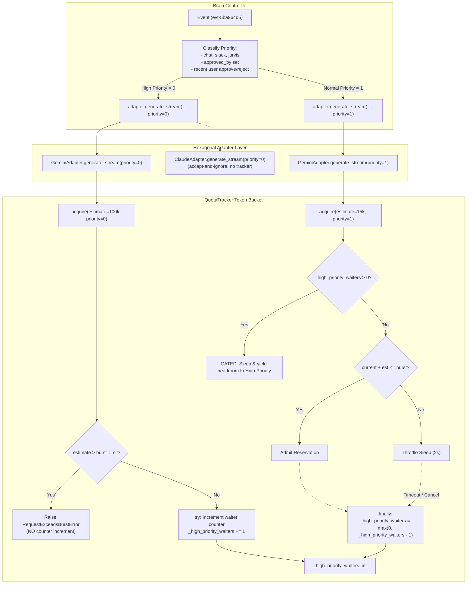

# Technical Implementation Plan: Priority-Aware Token Reservation & Starvation Prevention

**Jira Tracking:** [VMER-2246](https://redhat.atlassian.net/browse/VMER-2246) (Parent Epic: [VMER-62](https://redhat.atlassian.net/browse/VMER-62))

---

## 1. Problem Statement & Root Cause Synthesis

Under Vertex AI TPM quota constraints (typically 500k TPM burst limit), events in Darwin contend for admission within a rolling 60-second window.

### Observed Failure Mode (e.g. `evt-5ba964d5`)
1. **Context Size Disparity**: Small background events (automated Kargo promotions, GitOps monitors, CI alerts) request small token payloads (~15k–25k tokens). In contrast, user-driven events—especially events resuming post-approval after squad execution—carry full conversation histories, squad logs, and callback evidence (~80k–120k tokens).
2. **Cooperative Loop Starvation**: In `QuotaTracker.acquire()`, each caller checks `current + estimated_tokens <= self._burst_limit`. When the rolling 60s window drains slightly below the burst limit (e.g., to 480k tokens), small background requests immediately satisfy `480k + 15k = 495k <= 500k` and acquire reservations.
3. **Continuous Headroom Reset**: This constant trickle of low-priority background acquisitions resets the window back to ~495k tokens. A large pending user event requiring 100k tokens of headroom (needing the window to drain below 400k) repeatedly fails admission (`480k + 100k = 580k > 500k`), sleeping in 2s intervals until its acquisition budget (30s–120s) is exhausted.
4. **User Experience Impact**: The human user who just approved an action sits watching a frozen spinner while unrelated background automated tasks continuously consume Vertex AI quota.

### Window Drainage & Timing Analysis
At a 500k TPM rolling 60-second window, tokens expire linearly at an average rate of ~8.3k tokens/second (~500k / 60s). Over a 30-second `max_wait_seconds` interval, up to ~250k tokens naturally expire out of the window. By gating low-priority background events while a high-priority request is waiting, new token entry into the window drops to zero, allowing the window to drain from 500k down to ~250k well within the 30s deadline—easily clearing the headroom required for an 80k–120k token high-priority event.

---

## 2. Architecture & Closed-Loop Control Flow



---

## 3. Hexagonal Port/Adapter Design & Priority Mapping

### Priority Levels
```python
PRIORITY_HIGH: int = 0
PRIORITY_NORMAL: int = 1
```
- Lower numerical value indicates higher priority (standard priority queue semantics).
- Default priority is `PRIORITY_NORMAL` (`1`) for backwards compatibility with unannotated callers (e.g. Nightwatcher, Telemetry, and external scripts).

### Scope & Provider Boundaries
- `QuotaTracker` is specifically the token rate limiter for Gemini calls via Vertex AI.
- `ClaudeAdapter` uses Anthropic SDK / Bedrock / Vertex Claude, which operates without `QuotaTracker`. `ClaudeAdapter` accepts `priority: int = 1` for `LLMPort` protocol symmetry and ignores it without raising `AttributeError`.

### Brain Event Priority Classification
In `Brain._process_event_inner` before calling `self._adapter.generate_stream(...)`:
```python
is_high_priority = (
    event.source in ("chat", "slack", "jarvis")
    or bool(event.approved_by)
    or any(
        turn.actor == "user" and turn.action in ("approve", "reject")
        for turn in (event.conversation[-3:] if event.conversation else [])
    )
)
priority = 0 if is_high_priority else 1
```
*(Verified against live `EventDocument` and `ConversationTurn` in `src/models.py`: `actor="user"` and `action in ("approve", "reject")` are the canonical approval actions).*

### QuotaTracker Starvation Prevention & Leak-Free Counter Contract
1. **Burst Guard Placement**:
   - `if estimated_tokens > self._burst_limit:` check executes **first**. An oversize request raises `RequestExceedsBurstError` immediately without touching `self._high_priority_waiters`.
2. **Waiter Lifecycle**:
   - Callers with `priority <= PRIORITY_HIGH` increment `self._high_priority_waiters` inside a matched `try` block.
   - Guaranteed decrement in a `finally` block: `self._high_priority_waiters = max(0, self._high_priority_waiters - 1)`.
   - Ensures zero counter leakage across immediate return, loop return, timeouts (`QuotaExhaustedError`), cancellations (`asyncio.CancelledError`), or unhandled exceptions.
3. **Admission Gating & Bounded Deferral**:
   - Low-priority callers (`priority > PRIORITY_HIGH`) are blocked from acquiring quota as long as `self._high_priority_waiters > 0`.
   - Low-priority callers sleep in standard increments (`min(2.0, deadline - now)`), allowing the 60s rolling window to drain down to the level required by the waiting high-priority request.
   - **Trade-off Acknowledgment**: Gated low-priority callers may hit their `max_wait_seconds` under heavy high-priority bursts. This raises the **transient** `QuotaExhaustedError` (never permanent `RequestExceedsBurstError`), causing ReconcileScheduler resync to automatically retry the event on the next cycle without data loss or stuck queues.
   - When all high-priority requests finish or time out, `_high_priority_waiters` drops to `0`, immediately resuming normal cooperative admission for low-priority callers.
4. **Observability (PV)**:
   - Expose `"high_priority_waiters": self._high_priority_waiters` in `QuotaTracker.get_stats()` for `/telemetry/llm` inspection.

---

## 4. Implementation Steps

### Step 1: `src/agents/llm/quota_tracker.py` [Complicated]
- Add constants `PRIORITY_HIGH = 0` and `PRIORITY_NORMAL = 1`.
- Initialize `self._high_priority_waiters: int = 0` in `__init__`.
- Update `acquire(self, estimated_tokens: int, max_wait_seconds: float = 120.0, priority: int = PRIORITY_NORMAL) -> Reservation`.
- Place burst check first:
  ```python
  if estimated_tokens > self._burst_limit:
      raise RequestExceedsBurstError(...)
  ```
- Wrap acquisition loop with waiter tracking, preserving existing burst and throttle logging:
  ```python
  is_high_prio = priority <= PRIORITY_HIGH
  if is_high_prio:
      self._high_priority_waiters += 1
  try:
      while True:
          current = self._prune()
          if not is_high_prio and self._high_priority_waiters > 0:
              logger.debug(
                  "QuotaTracker: low-priority request gated by %d high-priority waiter(s)",
                  self._high_priority_waiters,
              )
          elif current + estimated_tokens <= self._burst_limit:
              now = time.monotonic()
              res = Reservation(id=str(uuid.uuid4()), tokens=estimated_tokens, timestamp=now)
              self._window.append((now, estimated_tokens, res.id))
              self._total_requests += 1
              self._total_tokens += estimated_tokens
              self._active_reservations[res.id] = res

              if current > self._sustained_limit:
                  logger.debug(
                      f"QuotaTracker: above sustained limit "
                      f"({current}/{self._sustained_limit}), allowing burst"
                  )
              return res

          if not throttled:
              self._throttle_events += 1
              throttled = True

          if time.monotonic() >= deadline:
              raise QuotaExhaustedError(...)

          wait = min(2.0, deadline - time.monotonic())
          logger.warning(
              f"QuotaTracker: throttling ({current}/{self._sustained_limit} tokens). "
              f"Waiting {wait:.1f}s..."
          )
          await asyncio.sleep(wait)
  finally:
      if is_high_prio:
          self._high_priority_waiters = max(0, self._high_priority_waiters - 1)
  ```
- Expose `"high_priority_waiters": self._high_priority_waiters` in `get_stats()`.

### Step 2: `src/agents/llm/types.py` [Clear]
- Update `LLMPort.generate` and `LLMPort.generate_stream` signatures to include `priority: int = 1`.

### Step 3: `src/agents/llm/gemini_client.py` & `src/agents/llm/claude_client.py` [Clear]
- In `GeminiAdapter.generate` and `GeminiAdapter.generate_stream`:
  - Accept `priority: int = 1`.
  - Pass `priority=priority` to `self._tracker.acquire(estimate, max_wait_seconds=30.0, priority=priority)`.
- In `ClaudeAdapter.generate` and `ClaudeAdapter.generate_stream`:
  - Accept `priority: int = 1` for `LLMPort` protocol conformance.
  - Do NOT call `self._tracker` (ClaudeAdapter does not maintain a quota tracker). Accept and ignore `priority`.

### Step 4: `src/agents/brain.py` [Clear]
- In `_process_event_inner` (line ~1940):
  - Determine `is_high_priority` from event source (`chat`, `slack`, `jarvis`), `event.approved_by`, or recent conversation turns (`actor == "user"` and `action in ("approve", "reject")`).
  - Pass `priority=0 if is_high_priority else 1` into `self._adapter.generate_stream(...)`.

### Step 5: `tests/test_quota_tracker.py` (Extend Existing) [Complicated]
- Add new test class `TestQuotaTrackerPriorityReservation`:
  - Test immediate acquisition for high priority when capacity exists (verifies zero waiter leak on fast path).
  - Test low-priority request gated while high-priority caller is waiting.
  - Test high-priority caller acquires before low-priority caller when capacity frees.
  - Test waiter counter decrements cleanly on timeout (`QuotaExhaustedError`).
  - Test waiter counter decrements cleanly on `asyncio.CancelledError`.
  - Test oversize high-priority request raises `RequestExceedsBurstError` without incrementing or leaking `_high_priority_waiters`.
  - Test `get_stats()` includes `high_priority_waiters`.

### Step 6: `tests/test_gemini_client_quota.py` (Extend Existing) [Clear]
- Test that `generate` and `generate_stream` pass `priority` through to `tracker.acquire`.
- Test that `ClaudeAdapter.generate` and `generate_stream` accept `priority` without error.

---

## 5. Verification & ATDD Definition of Done

1. **Unit Test Suite**:
   `pytest tests/test_quota_tracker.py tests/test_gemini_client_quota.py` passes 100% with no regressions.
2. **Brain Admission Suite**:
   `pytest tests/test_brain_admission.py` passes.
3. **No Tree Regression**:
   Verify full test run passes without disturbing uncommitted work in `src/agents/brain_skills/` and `src/agents/brain.py`.
4. **Hexagonal Boundary**:
   No direct coupling between Brain and `QuotaTracker`—all priority passes through `LLMPort` interface.

---

## Revision History

| Update | Source pre-flight | Confidence then | Summary |
| :--- | :--- | :--- | :--- |
| 2026-11-04 13:50 | `priority-aware-token-reservation-Pre-Flight-Review_2026-11-04_1350.md` | 62% Caution | PtG-1 (leak-safe placement & Complicated Cynefin), PtG-2 (Claude accept-and-ignore contract), PtG-3 (extend existing test files + oversize leak test), PtG-4 (drainage timing analysis) applied in place. |
| 2026-11-04 13:54 | `priority-aware-token-reservation-Pre-Flight-Review_2026-11-04_1354.md` | 90% Ready | PtG-C1 (bounded deferral trade-off documented), PtG-C2 (file path citation corrected to `src/models.py`), PtG-C3 (observability logging preserved in Step 1). |
